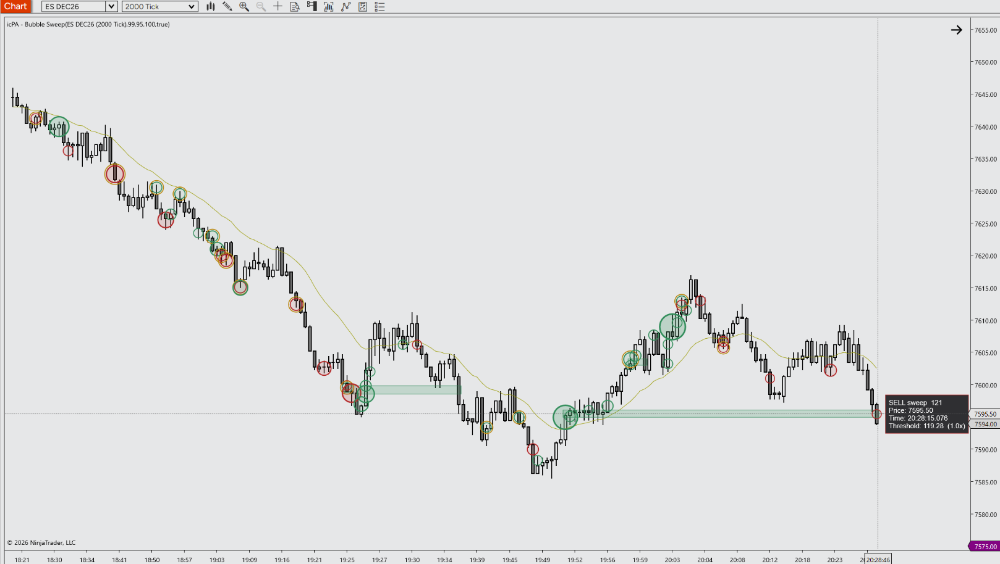

# icPA - Bubble Sweep for NinjaTrader 8

A specialized Indicator engineered for Price Action day trading. It finds the largest aggressive trades (sweeps) and draws them as volume-sized bubbles on their candle, with clustering zones where same-side sweeps stack up and a ring on sweeps that failed to move price.

---

## 📺 Video Walkthrough & Setup

Watch the complete breakdown of parameters, price action context, and chart examples on YouTube:

> **[▶ Click here to watch the full YouTube walkthrough](https://youtube.com/@icPriceAction)**

---

## ⚡ Key Features

- **Sweep Bubbles:** Trades on the same side at the same timestamp are combined into one sweep. Sweeps above the threshold are drawn at their volume-weighted price, with bubble area growing with volume. The threshold is adaptive by default (the top 0.05% of recent sweep sizes), so it works on any instrument without tuning. Buy/sell side comes from the bid/ask stamped on each trade.
- **Clustering Zones & Absorption:** Several same-side bubbles close in price and time form a zone that extends right until a bar closes through it or the session ends. A sweep that could not push price even one tick further within a few seconds gets an absorption ring.
- **Hover Tooltips & Strategy Outputs:** Hover a bubble to see its side, volume, price levels, time, threshold multiple and absorption status. Sweep counts, volumes, zone and absorption signals are exposed as series for strategies and other indicators.
- **PATS & Context Aligned:** Designed for Price Action principles (Mack / Thomas Wade) and disciplined futures execution.
- **Zero Chart Lag:** Native C# execution optimized to prevent UI freezes on high-frequency 2000-tick ES/MES charts.
- **Clean Visuals:** Complementary default palette that preserves candlestick clarity without chart clutter.
- **Fully Customizable:** Configure colors, thresholds, bubble sizing, zones and absorption via the native NT8 settings panel.

---

## ⚠️ Prerequisites & Data Requirements

- **Tick Replay:** Not required. The indicator adds its own 1-tick data series.
- **Historical tick data:** Required. Load as many days as you want bubbles for; more days means a longer load.
- **Bid/ask-stamped tick data:** Needed for accurate buy/sell sides (for example, NinjaTrader's own data feed). Without it, sides are estimated with the tick rule and a one-time warning is printed to the NinjaScript Output window.
- **Calculate:** On Each Tick (the default). A one-time warning is printed if it is set otherwise.
- **Bar type:** Works on any primary chart (tick, minute, range, etc.).
- **Strategy use:** A hosting strategy must add the same series in `State.Configure` with `AddDataSeries(BarsPeriodType.Tick, 1);` and call `icPABubbleSweep(minSweepVolume, useAdaptiveThreshold, adaptivePercentile)`. Output series: `BuySweepCount`, `SellSweepCount`, `BuySweepVolume`, `SellSweepVolume`, `LargestBuySweep`, `LargestSellSweep`, `BullishSweepSignal`, `BearishSweepSignal`, `SweepThreshold`, `BuyZoneSignal`, `SellZoneSignal`, `BuyAbsorption`, `SellAbsorption`. Absorption signals are set on the bar where absorption is confirmed, so there is no look-ahead.

---

## 📥 Installation Guide

1. Head to the **[Releases](https://github.com/icPriceAction/bubble-sweep/releases)** tab of this repository.
2. Download the latest release `.zip` file (`icPriceAction_icPABubbleSweep_v16.2.1.zip`).
   - *Note: Do NOT extract or unzip the file.*
3. Open **NinjaTrader 8**.
4. In the Control Center, navigate to:
   `Tools` ➔ `Import` ➔ `NinjaScript Add-On...`
5. Select the downloaded `.zip` file and click **Open**.
6. A success dialog will appear confirming the tool has been imported.
7. Open any chart, press `Ctrl + I`, find **icPA - Bubble Sweep** in the **icPA** folder, and add it.

---

## ⚙️ Parameters & Configuration

| Parameter | Group | Type | Default | Description |
| :--- | :--- | :--- | :--- | :--- |
| Use Adaptive Threshold | 1. General | bool | True | Show sweeps in the top percentile of recent sweep sizes, so the indicator adapts to any instrument and session. Turn off to use the fixed volume. |
| Adaptive Percentile | 1. General | double | 99.95 | Higher shows fewer, larger sweeps. 99.95 = the largest 0.05% of recent sweeps. |
| Adaptive Lookback (sweeps) | 1. General | int | 20000 | Number of recent sweeps the percentile is calculated over. |
| Adaptive Minimum Volume | 1. General | double | 0 | The adaptive threshold never goes below this volume (0 = no floor). |
| Fixed Minimum Sweep Volume | 1. General | double | 100 | Minimum total volume of a sweep when the adaptive threshold is off. |
| Real-time Flush Delay (ms) | 1. General | int | 300 | In real time, a sweep is closed and drawn after this many milliseconds without a new trade. |
| Use Outline Only | 2. Visuals | bool | True | Draws an empty ring instead of a filled bubble. |
| Base Bubble Diameter (px) | 2. Visuals | int | 20 | Diameter of a bubble whose volume exactly equals the threshold. Bubble area grows in proportion to volume above it. |
| Maximum Bubble Diameter (px) | 2. Visuals | int | 90 | Largest bubble size; very large sweeps are capped here. Never smaller than the base diameter. |
| Fill Opacity (%) | 2. Visuals | int | 40 | Fill transparency of the smallest bubbles; larger ones get more opaque. Only applies when Use Outline Only is off. |
| Intensity By Size | 2. Visuals | bool | True | Larger sweeps get a thicker outline and stronger fill, so the biggest stand out. |
| Buy Bubble Color | 2. Visuals | Brush | SeaGreen | Color for buy sweeps and buy (support) zones. |
| Sell Bubble Color | 2. Visuals | Brush | Firebrick | Color for sell sweeps and sell (resistance) zones. |
| Show Volume Text | 2. Visuals | bool | False | Print each sweep's volume inside its bubble. |
| Volume Text Color | 2. Visuals | Brush | Black | Color of the volume text inside bubbles. |
| Merge Bubbles Within Bar | 2. Visuals | bool | True | Combine same-side bubbles on the same bar that are within the merge distance into one bubble with their total volume. Keeps higher timeframes readable. |
| Merge Distance (ticks) | 2. Visuals | int | 2 | Maximum price distance between bubbles that are merged. 0 = same price only. |
| Show Tooltips | 2. Visuals | bool | True | Hover a bubble to see its volume, price levels, time, threshold and absorption. |
| Tooltip Font Size | 2. Visuals | int | 15 | Text size of the hover tooltip. |
| Show Clustering Zones | 3. Clustering Zones | bool | True | Draw a zone where several same-side bubbles cluster in price. |
| Minimum Bubbles | 3. Clustering Zones | int | 3 | Same-side bubbles needed to form a zone. |
| Price Range (ticks) | 3. Clustering Zones | int | 6 | Maximum distance between the highest and lowest bubble in a cluster. |
| Time Window (minutes) | 3. Clustering Zones | double | 5 | The clustered bubbles must fall within this many minutes. Time-based, so zones behave the same on any chart type. |
| Expire At Session End | 3. Clustering Zones | bool | True | Zones still active when the trading session ends stop at the session's last bar. |
| Show Broken Zones | 3. Clustering Zones | bool | True | Keep ended zones visible (stopping at the bar that broke them, or at the session end). |
| Zone Opacity (%) | 3. Clustering Zones | int | 20 | Fill transparency of clustering zones. |
| Show Absorption | 4. Absorption | bool | True | Mark bubbles whose sweep failed to move price further in its direction. |
| Window (seconds) | 4. Absorption | double | 5 | How long after the sweep price is watched. |
| Max Continuation (ticks) | 4. Absorption | int | 0 | If price trades more than this many ticks beyond the sweep's extreme within the window, it is not absorption. 0 = any trade beyond the extreme cancels it (strictest). |
| Ring Color | 4. Absorption | Brush | DarkGoldenrod | Color of the ring drawn around absorbed bubbles. |
| Print Diagnostics | 5. Diagnostics | bool | False | Prints classification, threshold, zone, absorption and performance details to the NinjaScript Output window when the indicator goes real time. Useful for tuning. |

---

## 📝 Changelog

- **v16.2.1** (2026-11-03) - Initial public release. Cleaned and optimized by icPriceAction.
- **v16.2.0**              - Code audit: Adaptive Percentile default 99.95; absorption windows follow NinjaTrader's clock (Playback-safe); mouse handler and brush fixes.
- **v16.1.0**              - Zone window in minutes; zones expire at session end; Merge Bubbles Within Bar.
- **v16.0.0**              - Diagnostics off by default (bid/ask warning only); maximum diameter clamp; softer size gradient; setting descriptions.
- **v15.1.0**              - Tooltip Font Size setting; stronger size gradient.
- **v15.0.0**              - Hover tooltips; Intensity By Size; absorption ring outside the outline.
- **v14.2.0**              - Removed Spread Bubbles Across Bar; Show Volume Text off and Use Outline Only on by default.
- **v14.1.0**              - Absorption Max Continuation default changed to 0 ticks.
- **v14.0.0**              - Absorption detection; BuyAbsorption / SellAbsorption series.
- **v13.0.0**              - Clustering zones; BuyZoneSignal / SellZoneSignal series.
- **v12.0.0**              - Adaptive percentile threshold; SweepThreshold series.
- **v11.1.0**              - Fixed bubbles landing between candles.
- **v11.0.0**              - Direct SharpDX bubble rendering; bubble area scales with volume.
- **v10.2.0**              - Classification from the bid/ask stamped on each trade.
- **v10.1.0**              - Diagnostics output.
- **v10.0.0**              - Bid/ask aggressor classification with tick-rule fallback.
- **v9.1.0**               - Bubbles anchored to the bar the sweep was attributed to.
- **v9.0.0**               - Output series; real-time signal, bar attribution and flush fixes.
- **v8.0.0**               - Workspace save fixes; cross-series safety checks.

---

## ☕ Support the Project

All tools provided by **icPriceAction** are 100% free and open-source for personal trading use. These tools, even thou supported by AI have taken considerable time to design, build, test and package. If these tools bring you value, consider supporting continued development:

- **Prop Firm Traders:** Use discount code **`ICPAT`** at checkout across top futures prop evaluation firms ([View Active Discounts](https://icpriceaction.com/prop-firms.html)).
- **Profitable Traders:** Send a one-time tip to support my continued support and time, server hosting and open-source updates via [Buy Me a Coffee](https://buymeacoffee.com/icpriceaction).

---

## 🐛 Bug Reports & Feature Requests

Found an issue or have an enhancement idea?
Please submit an issue on the [Issues tab](https://github.com/icPriceAction/bubble-sweep/issues).

---

## License

Free for personal trading use. Commercial resale, redistribution, or repackaging is strictly prohibited. See [LICENSE](LICENSE).

---

## ⚖️ Disclaimer

Futures trading involves substantial risk of loss and is not suitable for every investor. All indicators, drawing tools, strategies, and documentation provided by **icPriceAction** are for educational and analytical purposes only. Nothing herein constitutes financial or investment advice. Automated strategies can lose money and may behave differently in live markets than in simulation or backtests.

NinjaTrader® is a registered trademark of NinjaTrader, LLC. icPriceAction is an independent developer with no official affiliation to NinjaTrader, LLC.